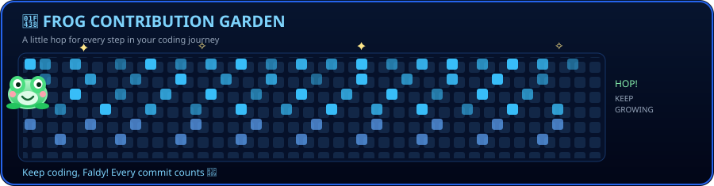

 

<h1>💙 Hi, I'm Faldy Ardiansyah 🐸</h1>

<strong>Software Engineering Student | Mobile & Backend Developer</strong>

 

  

---

## 💙 About Me

*Welcome to my little corner of the coding world! ✨*

Hi! I'm **Faldy Ardiansyah**, a Software Engineering student at Politeknik Negeri Indramayu. I enjoy learning new technologies and building useful digital applications.

- 🎓 Software Engineering Student
- 📱 Mobile development with Flutter and GetX
- ⚙️ Backend development with Go and Laravel
- 🌐 Exploring React and modern web technologies
- 🗄️ Working with MySQL and REST APIs
- 🐳 Learning Docker and development workflows
- 🚀 Always learning, building, and improving

*"Code. Learn. Build. Grow."* 💙

---

## 🛠️ Tech Stack & Skills

**📱 Mobile Development**

**⚙️ Backend Development**

**🌐 Web Development**

**🔧 Tools & Workflow**

---

## 📊 GitHub Statistics

  

---

## 🐸 Frog Contribution Garden

**🐸 Hop • Collect • Keep Coding! 💙**

Every little step counts. Keep learning, keep building, and keep growing!

---

## 🌱 Currently Growing

| 💎 Focus | 🚀 My Journey |
|:---:|:---|
| 📱 Mobile | Flutter & GetX |
| ⚙️ Backend | Go, Laravel & REST APIs |
| 🌐 Web | React & modern web technologies |
| 🗄️ Database | MySQL & data integration |
| 🔌 API Testing | Postman |
| 🐳 DevOps | Docker & development workflows |

---

## 🤝 Connect With Me

  

### Thanks for visiting my profile! 💙

*Jangan lupa follow kalau kamu suka karya dan project-ku. See you around! 🚀🐸*

